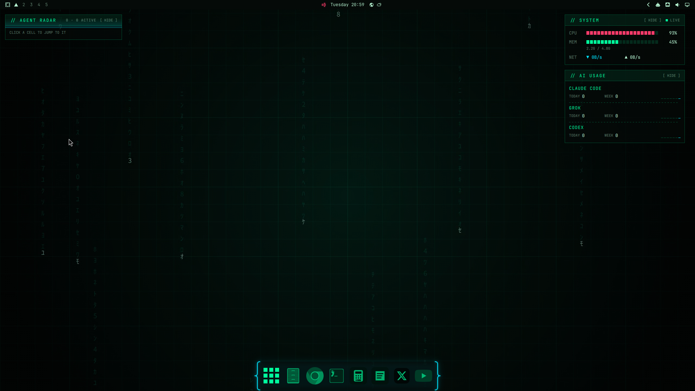
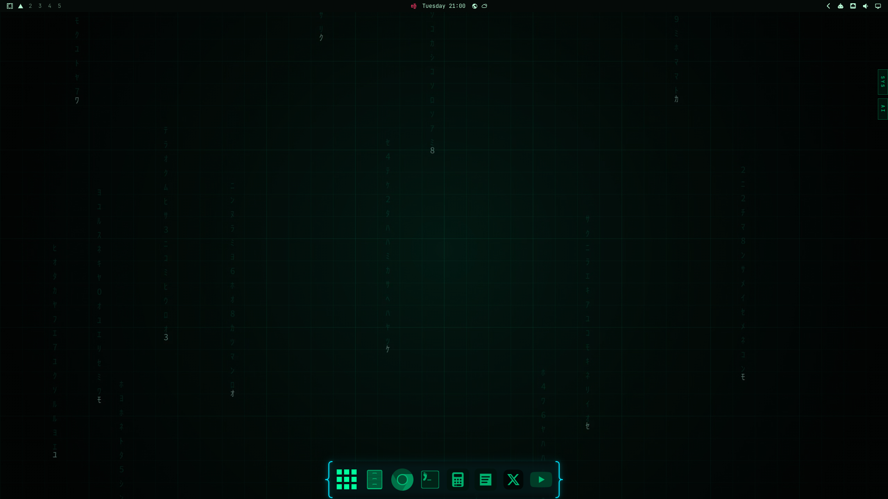
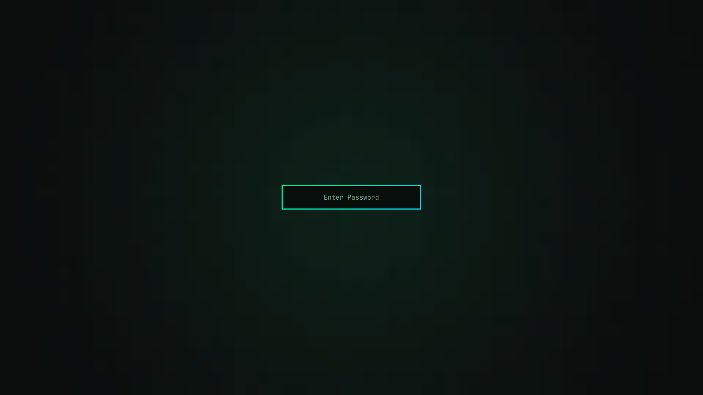

# Omarchy Hacker Neon

A Matrix-style desktop for [Omarchy](https://omarchy.org): a green-on-black
theme with a code-rain wallpaper, a neon dock, a HUD and an agent radar on the
desktop, and, if you want her, **Trinity**, a voice and chat assistant with a
holographic orb.



**Using an AI agent?** Point it at this repo and ask it to set everything up.
[AGENTS.md](AGENTS.md) has its instructions.

## What you get

| Piece | Folder | What it is |
|---|---|---|
| **Hacker Neon theme** | `theme/hacker-neon` | Matrix green (`#00ff9c`) and cyberpunk cyan (`#00e5ff`) on near-black; a green-to-cyan border and a green glow on the focused window, square corners, tight gaps; a code-rain video wallpaper (and a grid); green icons; a green lock screen. Omarchy colors the bar, menus, notifications, terminals and editors from it. |
| **Neon Dock** | `plugins/marcho.dock` | Omarchy's dock restyled: `{ }` braces at the ends, green icons, `[ ]` brackets on hover, and an app drawer in the same style. It shows on floating workspaces and hides until the pointer reaches it. |
| **Neon HUD** | `plugins/marcho.hud` | Top right: `// SYSTEM` (live CPU, memory, network) and `// AI USAGE` (your coding agents' tokens and limits). [More](plugins/marcho.hud/README.md) |
| **Agent Radar** | `plugins/marcho.radar` | Top left: your [herdr](https://herdr.dev) coding agents as hex cells, lit by whether they're working, need you, are done or idle. Click one to jump to it. [More](plugins/marcho.radar/README.md) |
| **Widget keys** | `scripts/o-widgets`, `hypr/bindings.lua` | Hide or show the widgets: each one's `[ HIDE ]` button leaves a tab at its edge, and three keys work on all of them. |
| **Trinity** (optional) | `trinity/` | A voice and chat assistant: a holographic orb while she talks, desktop actions, YouTube on the desktop, lists that decode onto the wallpaper, and a mute button on the bar. Needs an xAI account. [More](trinity/README.md) |



## Requirements

- **Omarchy 4.5.** It was built on 4.5.0rc1 and tested on a fresh 4.5.0rc3,
  both from Omarchy's `rc` channel. Check with `omarchy version`. Omarchy's
  stable release is still 4.0.6, which this hasn't been tested on; the test
  machine was moved to 4.5 with `omarchy channel set rc`.
- `python3` (comes with Omarchy), for the widget keys and the radar's clicks.
- **For `// AI USAGE`:** Omarchy's Agents widget on the bar, with your agents
  signed in. It writes the usage the HUD shows.
- **For the Agent Radar:** herdr 0.9.5, installed in step 4.
- **For Trinity:** see [her requirements](trinity/README.md#requirements).

## Install

Run these from this folder. Steps 1–6 make the look; step 7 adds Trinity.

1. **The theme:**

   ```bash
   mkdir -p ~/.config/omarchy/themes
   cp -r theme/hacker-neon ~/.config/omarchy/themes/
   omarchy theme set hacker-neon
   ```

2. **The plugins** (a plugin's folder name must be its id, as here):

   ```bash
   mkdir -p ~/.config/omarchy/plugins
   cp -r plugins/marcho.dock plugins/marcho.hud plugins/marcho.radar ~/.config/omarchy/plugins/
   omarchy-shell shell rescanPlugins
   omarchy plugin disable omarchy.dock
   omarchy plugin enable marcho.dock
   omarchy plugin enable marcho.hud
   omarchy plugin enable marcho.radar
   ```

   The shell reloads its plugins after a rescan and doesn't answer for a
   while. If a command says *omarchy-shell is not responding*, wait half a
   minute and run it again (not the rescan: each rescan reloads it again).

3. **The settings:** the dock hides until the pointer reaches it, and the AI
   usage updates every 30 seconds instead of every 15 minutes:

   ```bash
   omarchy dock autohide on
   omarchy bar set omarchy.agents refreshIntervalSec 30 --json
   ```

4. **herdr,** for the Agent Radar:

   ```bash
   mise use -g herdr@0.9.5
   ```

   Then start herdr (run `herdr` in a terminal). The radar shows **HERDR
   OFFLINE** until herdr runs, then your agents as they start.

5. **The widget script:**

   ```bash
   mkdir -p ~/.local/bin
   install -m 755 scripts/o-widgets ~/.local/bin/
   ```

6. **The keys:** add the lines in [`hypr/bindings.lua`](hypr/bindings.lua) to
   `~/.config/hypr/bindings.lua`. Hyprland picks them up on its own.

7. **Trinity** (optional): follow [trinity/README.md](trinity/README.md). She
   needs an xAI account, Node, a systemd user service, and a wake word you
   train yourself; Super+Z works without the wake word.

## Using it

| To | Do |
|---|---|
| Hide or show all the widgets | **Super+Alt+H** |
| Pick which widgets show | **Super+Alt+W** |
| Hide one widget | Its `[ HIDE ]` button; it leaves a tab at its edge (SYS and AI on the right, RADAR on the left). Click the tab to bring it back. |
| Jump to a coding agent | Click its cell on the Agent Radar |
| See the dock | Use a floating workspace and move the pointer to the bottom edge |
| Talk to Trinity | **Super+Z** (see [her guide](trinity/README.md#using-her)) |
| Put a list on the desktop | Ask Trinity, e.g. *"put today's top news on my desktop"*; Super+Alt+X clears it ([more](trinity/README.md#the-board-lists-that-decode-onto-the-wallpaper)) |
| Play a YouTube video on the desktop | Ask Trinity, e.g. *"play the newest Kurzgesagt video"*; it can go full screen or pop out ([more](trinity/README.md#the-video-youtube-on-the-desktop)) |



## Undo

```bash
omarchy theme set <another theme>
rm -rf ~/.config/omarchy/themes/hacker-neon
omarchy plugin disable marcho.dock
omarchy plugin disable marcho.hud
omarchy plugin disable marcho.radar
omarchy plugin enable omarchy.dock
rm -rf ~/.config/omarchy/plugins/marcho.{dock,hud,radar}
rm ~/.local/bin/o-widgets
```

Take the widget keys out of `~/.config/hypr/bindings.lua`. For Trinity, see
[Remove her](trinity/README.md#remove-her).

## Known issues

- **Agent Radar:** with no agents its panel is short, and when hidden, its
  RADAR tab ends up outside its window, so there's no tab to click. Bring it
  back with Super+Alt+W (tick it), or run `o-widgets show radar`.
- **Trinity:** without an xAI key, Super+Z does nothing visible; the reason
  ("No xAI API key") is only in her log (`journalctl --user -u trinity`).

## What's where

| Folder | What |
|---|---|
| `theme/hacker-neon/` | The theme: `colors.toml`, `hyprland.lua` (borders, glow, blur for the dock and HUD), `backgrounds/`, `icons.theme`, `unlock.png` |
| `plugins/` | The Neon Dock, Neon HUD and Agent Radar, each an Omarchy shell plugin |
| `scripts/o-widgets` | Hides and shows the widgets; its state is in `~/.local/state/o-interfaces/widgets.json` |
| `hypr/bindings.lua` | The keys to add |
| `trinity/` | Trinity: her shell plugin, her service, the wake word detector, and the scripts to train your own wake word |
| `docs/screenshots/` | The pictures above |
